# Hi, I'm Denis

## About me

I'm a 3rd-year Automation and Computer Science student at "Gheorghe Asachi" Technical University of Iași. 
Right now I'm learning cybersecurity: networking, Linux and hands-on labs on TryHackMe. 
I'm competitive, I work hard and I usually have a project in progress. 
If you're working on a cybersecurity project, I'd be glad to collaborate.

## Projects

| Project | Description |
| ------- | ----------- |
| [Vulnerability Scan Report](https://github.com/NixDennis/Vulnerability-Scan-Report) | Flask web app for non-intrusive vulnerability assessment of lab hosts, with risk classification and PDF reports |
| [Port Scanner](https://github.com/NixDennis/Port-Scanner) | TCP port scanner with banner grabbing, written in pure Python |
| [Denis Cyber Lab](https://github.com/NixDennis/Denis-Cyber-Lab) | My home lab: TryHackMe progress, notes, Python scripts and VirtualBox experiments |

## Socials

 

## Tech stack

      

## GitHub stats

 
 

## Contributions

